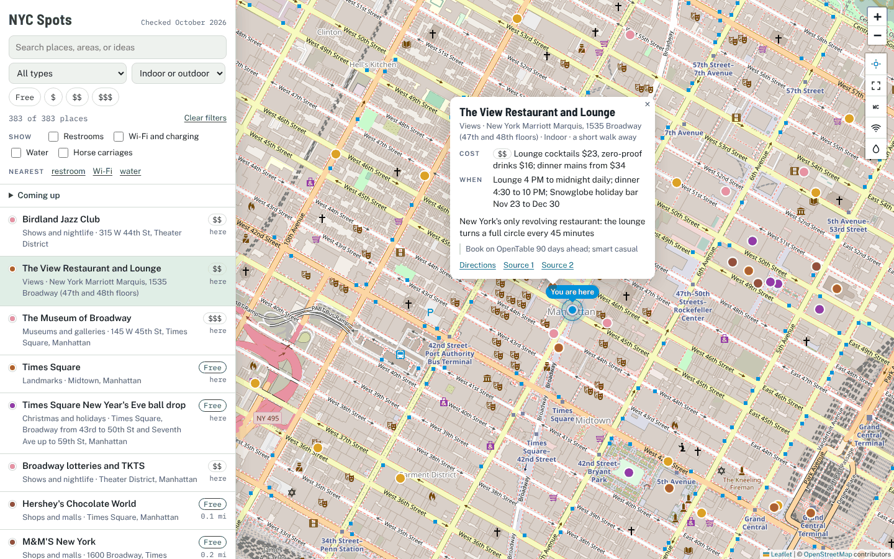
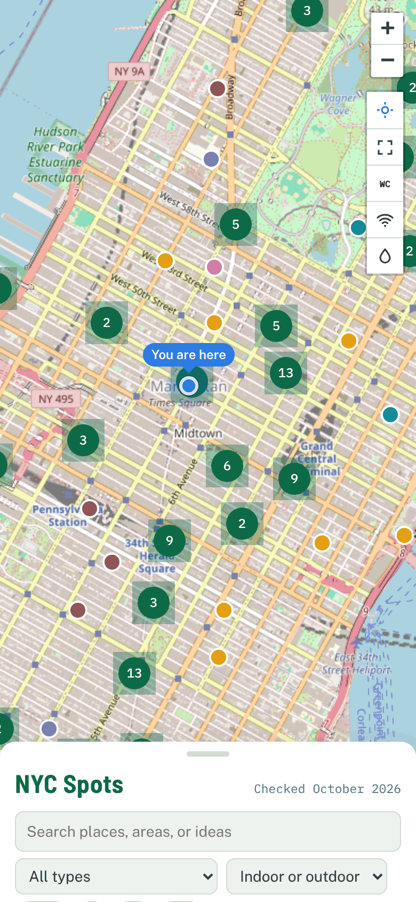

# NYC Spots: things to do, date ideas, free restrooms and Wi-Fi in New York City

**Live map: https://devharsh.github.io/nyc-spots-map/**

**Guide (every place as text): https://devharsh.github.io/nyc-spots-map/guide.html**

NYC Spots is a free, mobile-friendly map and guide of things to do in and around New York City. It covers date ideas, free things to do, landmarks and views, parks, museums, food, Michelin-starred restaurants, shows and nightlife, classes, fireworks and parades, Halloween and Christmas events, and day trips from NYC. It also maps free public restrooms, free Wi-Fi and phone charging, free drinking water, and the Central Park horse carriage stands near you. Each place lists its cost, hours or dates, and a tip, and most link the sources used to check them.

## What you can do

- See where you are: allow location access to get a blue You are here dot and distances to every place. Your location stays in your browser.
- Find things to do: filter by type, by cost (Free, $, $$, $$$), by indoor or outdoor, or by a search word, and tap a pin or a list item for details and directions. The Indoor filter is handy on rainy or cold days; places that are partly indoors show in both.
- Find a free public restroom: turn on the WC layer or tap Nearest restroom. Restrooms come from the city's Public Restrooms dataset on NYC Open Data, plus a few near Times Square checked by hand (transit hubs, a plaza, Hoboken Terminal, Liberty State Park).
- Find free Wi-Fi and phone charging: turn on the Wi-Fi layer or tap Nearest Wi-Fi. It shows working LinkNYC kiosks from the city's kiosk status data (free Wi-Fi, two USB charging ports, free calls in the U.S.), public library branches with free Wi-Fi (New York City plus 10 Jersey City branches), and places whose own pages confirm free Wi-Fi, such as the Oculus, Moynihan Train Hall, Port Authority Bus Terminal, and Manhattan West.
- Find free drinking water: turn on the Water layer or tap Nearest water. It shows NYC Parks drinking fountains within 10 km (6.2 miles) of Times Square from the city's drinking fountain data on NYC Open Data, including which ones have a bottle filler or a dog bowl and which are indoors. NYC Parks turns most outdoor fountains off for much of the fall and winter, so check that a fountain is running.
- Take a carriage ride: turn on Horse carriages to see the three pick-up lines inside Central Park along Central Park South, with the city's maximum fare, hours, and weather rules. The City Council voted on October 22, 2026 to end carriage rides by June 1, 2028.
- Plan ahead: the Coming up list shows dated events such as fireworks, parades, and holiday shows. Events hide themselves after their last day.
- Share a place: links like https://devharsh.github.io/nyc-spots-map/#p-L10 open that place on the map.

Prices, hours, and dates were checked in October 2026, mostly on official sites. Confirm before you go.

## Files

- `index.html`: the map.
- `guide.html`: the same places as a plain, crawlable guide with answers to common questions.
- `wifi.json`: the Wi-Fi and charging layer, loaded only when you turn it on.
- `water.json`: the drinking water layer, loaded only when you turn it on.
- `bikes.json`: Citi Bike station locations for a bike layer that is switched off for now.
- `docs/`: the screenshots in this README.
- `llms.txt`: a short summary of the site for AI tools.
- `sitemap.xml`: the two pages for search engines.
- `og-image.png`: the preview image used when the link is shared.
- `vendor/`: Leaflet and Leaflet.markercluster with their licenses.

## Credits

Map data and tiles: OpenStreetMap contributors (https://www.openstreetmap.org/copyright). Mapping library: Leaflet (BSD-2-Clause) and Leaflet.markercluster (MIT); their licenses are in `vendor/`. Public restrooms, LinkNYC kiosks, library branches, and drinking fountains: NYC Open Data. Horse carriage pick-up lines: Central Park Conservancy; fares: NYC Department of Consumer and Worker Protection.
